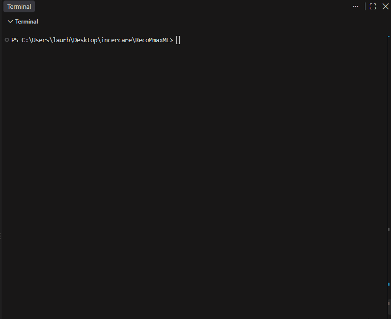

# RecoMMaxML

RecoMMaxML is an intelligent application that transforms a natural language query into a set of structured filters to find, filter, and score the most relevant B2B companies from a database.

The application solves the mismatches between how users formulate searches and how data is stored, applying an optimal balance between speed, cost, and accuracy. For in-depth technical details and architectural decisions, consult the `WRITEUP.md` file.

## 🚀 How to use

The project is cross-platform and runs directly using the included automation scripts, which handle the creation of the virtual environment and the installation of dependencies.

**Prerequisite:** Copy the `.env.example` file to `.env` and add the `GEMINI_API_KEY` key. (The scripts will automatically guide you if you forget this step).

### Windows
Use the `run.bat` executable from the project root:
-   **Interactive Mode:** `run` (Enter queries manually from the keyboard).
-   **Batch Mode:** `run --file query_list.txt` (Automatically processes a list of queries).

### Mac / Linux
Use the `run.sh` script (requires execution rights: `chmod +x run.sh`):
-   **Interactive Mode:** `./run.sh`
-   **Batch Mode:** `./run.sh --file query_list.txt`

---

## 📂 Results structure (Output)

For a clean user experience, the console will only display the essential information (Company name and Website). All technical data, algorithm decisions, and logs are automatically saved after each run in a newly structured directory like this: `results/$datetime/`

-   `log.txt`: The detailed execution journal (extracted conditions, API status, errors).
-   `top.txt`: The clean summary of the console display.
-   `query_list.jsonl`: The run history with the status and time metrics for each query.
-   `company_lists/`: `.jsonl` files per query containing the complete profiles of the qualified companies.
-   `telemetry_list/`: `.json` files with transparent details about how each company's score was calculated.

---

## ⚙️ Working Method (Processing Pipeline)

The system works in a flow of 3 main stages:

### 1. Query Division
The query is segmented into contextual conditions that are tested individually. It relies on a hybrid model:
-   **Local (Rules / Regex):** Extracts the safe arguments at maximum speed (e.g.: number of employees, location, revenue).
-   **API Call (LLM):** Provides intelligent context and semantic expansion for interpretable criteria (industries, offerings, target markets).

### 2. Sorting (Hard Knockout)
Massively filters the database using the extracted objective information (via the Batching method).
-   Uses the **"Benefit of the Doubt"** principle: If a company has a missing objective field (e.g.: revenue null), it is kept as a potential candidate.
-   **NAICS** codes and basic lexical matches work as *hard* filters to remove obvious noise.

### 3. Scoring (Semantic Grading)
Ranks the companies that passed the Hard filter based on relevance.
-   **Dynamic Mathematical Normalization:** The score ceiling adjusts depending on the number of criteria requested by the query.
-   **Fine Tie-breaking:** Ties are broken through *Term Frequency* and a company profile *Density Bonus*.
-   **Dynamic Thresholding:** The leader's score is evaluated and a threshold (cutoff) is applied to cut the "tail" of the list, returning only truly relevant companies, without artificially filling the ranking.
